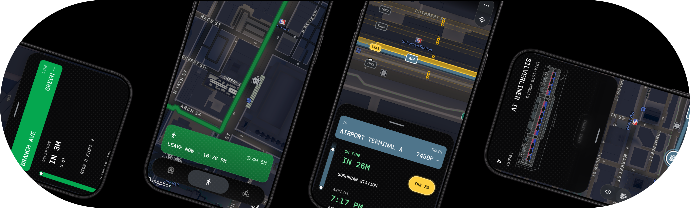

<picture>
  <source media="(prefers-color-scheme: light)" srcset="https://github.com/benpark202/benpark202/blob/main/Banner_Official.png?raw=true">
  <source media="(prefers-color-scheme: dark)" srcset="https://github.com/benpark202/benpark202/blob/main/Banner_Official.png?raw=true">
  
</picture>
<br>
<br>
<br>
<h1 align="center">Hi there, I'm Ben</h1>
<br>
<br>

```bash
$ dev init

>  LANGUAGES
  # HTML/CSS, TS/JS Python, Java, Swift

>  FRAMEWORKS 
  # Node.js, React, Flask, Vite, Django, Matplotlib
```
