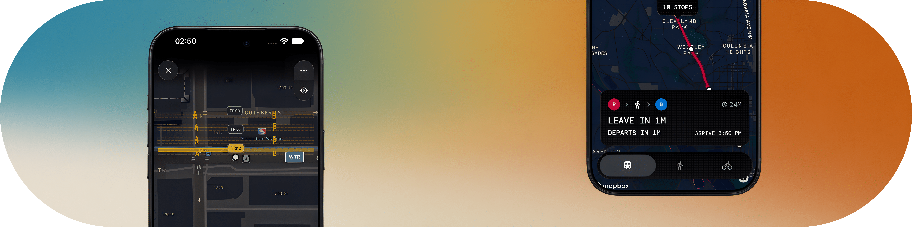

<picture>
  <source media="(prefers-color-scheme: light)" srcset="https://github.com/benpark202/benpark202/blob/main/Banner_2.0.png?raw=true">
  <source media="(prefers-color-scheme: dark)" srcset="https://github.com/benpark202/benpark202/blob/8c43307fb6a4cc2cb4b1ed54072447e3a9d1b9d1/DarkBanner.png">
  
</picture>
<br>
<br>
<br>
<h1 align="center">i'm ben</h1>
</p>
<br>

```bash
>  LANGUAGES
  # Python
  # Java
  # HTML/CSS/JS
  # Typescript
  # Swift

>  FRAMEWORKS 
  # Node.js
  # Express
  # SwiftUI
  # React
  # Flask
  # Tailwind
  # Django

```
<br>
<div align="center">

### [linkedin](https://linkedin.com/in/benjajpark) · [website](https://benpark.dev)

</div>
